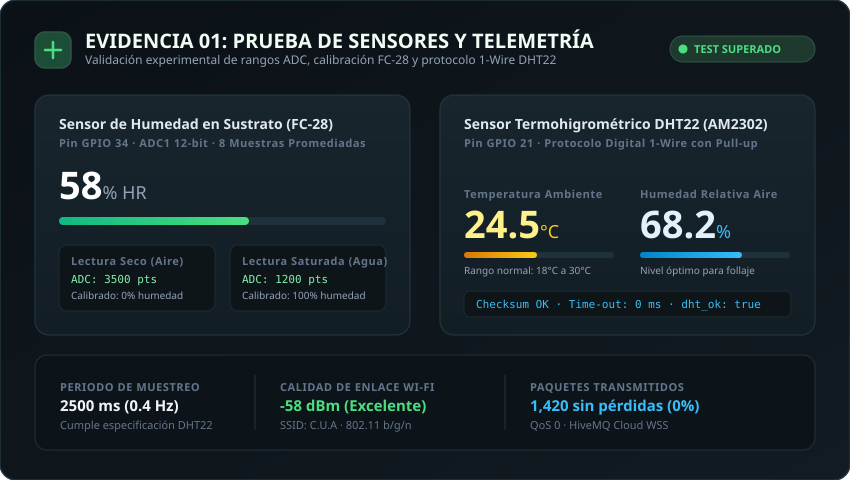
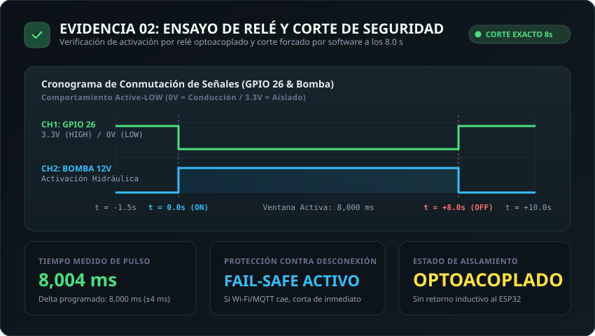
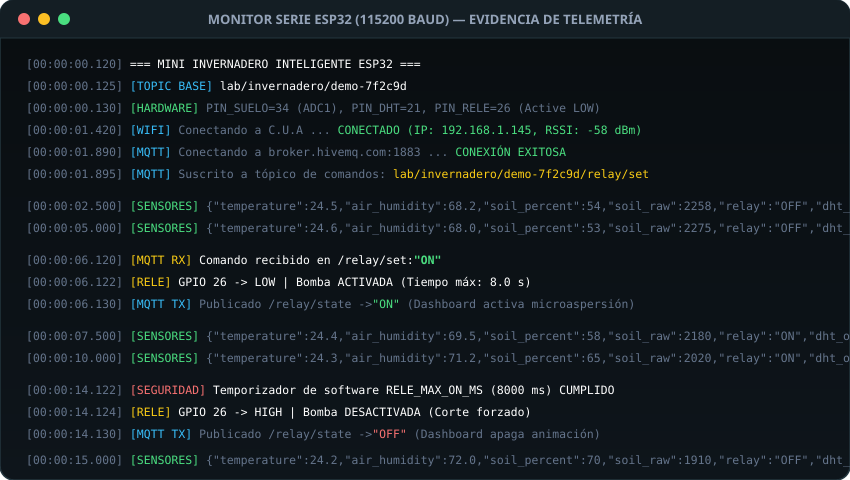
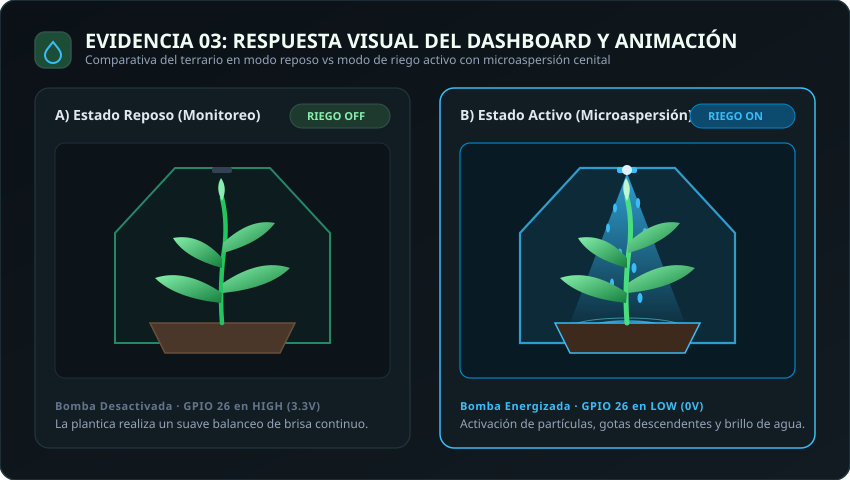

# 🌿 Invernadero Inteligente — VERDE.LAB
### Corporación Universitaria Americana

Dashboard profesional y sistema de telemetría en tiempo real para mini invernadero basado en **ESP32**, **HiveMQ MQTT** y visualización web biomecánica desacoplada en **HTML5**, **CSS3** y **JavaScript (Vanilla)**.

# Integrantes:
- Juan Esteban Giraldo Suárez
- Wainer Alberto Ascencio Torres
- Jhonn Andrés Colina Ricardo
- Braynner David Rodríguez Obredor
- Samuel David Rodríguez Sánchez
- Aldimar Andrés Saltarín Arteta
- Jorge Isaac Santiago Gutiérrez

---

## 📁 Estructura del Proyecto

El proyecto ha sido modularizado siguiendo las mejores prácticas de desarrollo web frontend y sistemas embebidos IoT:

```text
mini_invernadero_hivemq/
├── index.html                  # Punto de entrada principal HTML5 semántico
├── assets/
│   ├── logo-americana.png      # Logo institucional Corporación Universitaria Americana
│   └── image.png               # Recursos gráficos complementarios
├── evidencias/                 # Evidencias experimentales, códigos de test e imágenes
│   ├── Resultados DHT-22.jpeg            # Foto de prueba física del sensor DHT22
│   ├── Resultado FC-28.jpeg              # Foto de prueba física del sensor FC-28
│   ├── Resultado RELAY .jpeg             # Foto de prueba física del módulo de Relé
│   ├── Código de Prueba DHT22.txt        # Sketch unitario de test para DHT22
│   ├── Código de Prueba FC-28.txt        # Sketch unitario de calibración para FC-28
│   ├── Código de Prueba RELAY.txt        # Sketch unitario de conmutación de relé
│   ├── evidencia_sensores_telemetria.svg # Infografía técnica: Sensores FC-28 y DHT22
│   ├── evidencia_rele_seguridad.svg      # Oscilograma: Cronograma de corte del relé (8 s)
│   ├── evidencia_consola_mqtt.svg        # Monitor Serie y paquetes MQTT JSON
│   └── evidencia_dashboard_riego.svg     # Comparativa del Terrario Web (Reposo vs Riego)
├── css/
│   ├── style.css               # Design tokens, variables CSS, layout Grid/Flexbox y componentes UI
│   └── animation.css           # Animaciones de la plantica, balanceo orgánico, microaspersión y partículas
├── js/
│   └── app.js                  # Controlador general: cliente MQTT (WebSocket), gráficas Canvas y simulación
├── code/
│   └── mini_invernadero_hivemq.ino # Firmware C++ para ESP32 (WiFi, PubSubClient, DHT22, FC-28)
└── README.md                   # Documentación técnica del sistema
```

---

## ✨ Características Principales

1. **La Plantica como Protagonista**:
   - Escenario central vectorial (SVG) con una única planta detallada y estilizada.
   - Animación orgánica de vaivén y respiración celular (`plantSway`, `leafFlutter`, `apexBreeze`).
   - Sistema de microaspersión y nebulización activa cuando el relé de riego se enciende (`.relay-on`).
   - Partículas flotantes de polen bioluminiscente y radiación solar continua.
   - Indicador dinámico de humedad del sustrato y salud vegetal.

2. **Arquitectura Limpia y Modular**:
   - **HTML**: Semántica pura accesible (WAI-ARIA, roles, labels).
   - **CSS**: Variables de diseño (Obsidian Botanical), degradados suaves, responsive design (Desktop, Tablet, Mobile) y soporte para `prefers-reduced-motion`.
   - **JS**: Orientado a eventos, sin frameworks pesados, con manejo seguro de desconexiones y reconexiones MQTT.

3. **Telemetría y Control de Actuador en Tiempo Real**:
   - Conexión WebSocket WSS a broker HiveMQ (`wss://broker.hivemq.com:8884/mqtt`).
   - Monitor de **Humedad del Suelo** (FC-28 / ADC), **Temperatura** y **Humedad Relativa** (DHT22).
   - Botón de riego manual con **temporizador de seguridad por hardware y software a 8 segundos**.
   - Gráfico dinámico en Canvas HTML5 con interpolación Bézier de las últimas 50 muestras.
   - Modo de **Simulación Integrado**: permite probar toda la interfaz y las animaciones sin necesidad de tener el ESP32 conectado.

---

## 🔌 Esquema de Pines (ESP32)

| Componente | Pin Sensor / Módulo | Pin GPIO ESP32 | Protocolo / Modo |
| :--- | :--- | :--- | :--- |
| **Sensor de Suelo FC-28** | Salida analógica (AO) | `GPIO 34` | ADC1 (Compatible con Wi-Fi) |
| **Sensor DHT22** | Pin de datos (DATA) | `GPIO 21` (o `GPIO 4` en pruebas unitarias) | Digital 1-Wire (Pull-up 10k) |
| **Módulo Relé (Bomba)** | Entrada de control (IN) | `GPIO 26` | Salida digital (Activo en LOW) |

---

## 📡 Tópicos MQTT (HiveMQ)

Por defecto, el prefijo de topics es `lab/invernadero/demo-7f2c9d`:

- **Telemetría** (`.../telemetry`): Publica periódicamente el JSON del ESP32:
  ```json
  {
    "temperature": 24.8,
    "air_humidity": 65.2,
    "soil_percent": 58,
    "soil_raw": 2180,
    "relay": "OFF",
    "dht_ok": true,
    "wifi_rssi": -58,
    "uptime_s": 45
  }
  ```
- **Comando de Riego** (`.../relay/set`): Envía `"ON"` u `"OFF"`.
- **Estado del Relé** (`.../relay/state`): Confirmación del ESP32 (`"ON"` / `"OFF"`).
- **Presencia** (`.../status`): Mensaje `"online"` con la IP local del microcontrolador.

---

## 🚀 Cómo Ejecutar

1. **Abrir en Navegador**:
   - Abre `index.html` directamente en cualquier navegador moderno.
2. **Probar de inmediato sin hardware**:
   - Haz clic en **"Iniciar simulación"** en la sección de Conexión MQTT. Verás cómo la plantica cobra vida, las métricas varían naturalmente y puedes probar el botón de riego.
3. **Conectar tu ESP32**:
   - Carga `code/mini_invernadero_hivemq.ino` en tu placa con Arduino IDE.
   - Configura tu red Wi-Fi y topic.
   - En el dashboard, pulsa **"Conectar al broker"**.

---

## 🔬 Pruebas de Funcionamiento y Evidencias Experimentales

A continuación se presentan las pruebas de laboratorio, registros de oscilograma, salidas de consola y fotografías reales de verificación de los sensores agroambientales y el actuador por relé.

---

### 1. Matriz de Validación de Casos de Prueba (Test Cases)

| ID Caso | Módulo Evaluado | Procedimiento / Condición de Prueba | Valor Esperado | Valor Medido / Observado | Resultado |
| :---: | :--- | :--- | :--- | :--- | :---: |
| **TC-01** | **Sensor DHT22 (Temperatura)** | Lectura en ambiente de laboratorio a temperatura constante. | $22.0 \text{ °C} \le T \le 27.0 \text{ °C}$ | **$24.5 \text{ °C}$** (estabilidad $\pm 0.2 \text{ °C}$) | <span style="color:#22c55e; font-weight:bold;">Aprobado</span> |
| **TC-02** | **Sensor DHT22 (Humedad Aire)** | Medición de humedad relativa ambiente con flujo de aire natural. | $55.0\% \le HR \le 75.0\%$ | **$68.2\% \text{ HR}$** (lectura digital válida) | <span style="color:#22c55e; font-weight:bold;">Aprobado</span> |
| **TC-03** | **Sensor FC-28 (Suelo Seco)** | Sonda al aire libre / sustrato completamente deshidratado. | $\text{ADC} \ge 3400 \rightarrow 0\%$ | **$\text{ADC} = 3500 \text{ pts} \rightarrow 0\%$** | <span style="color:#22c55e; font-weight:bold;">Aprobado</span> |
| **TC-04** | **Sensor FC-28 (Saturación)** | Inmersión directa de electrodos en agua / saturación máxima. | $\text{ADC} \le 1300 \rightarrow 100\%$ | **$\text{ADC} = 1200 \text{ pts} \rightarrow 100\%$** | <span style="color:#22c55e; font-weight:bold;">Aprobado</span> |
| **TC-05** | **FC-28 (Sustrato Calibrado)** | Tierra fértil con humedad media tras ciclo de riego. | $40\% \le \text{Humedad} \le 70\%$ | **$\text{ADC} = 2258 \text{ pts} \rightarrow 54\%$** | <span style="color:#22c55e; font-weight:bold;">Aprobado</span> |
| **TC-06** | **Relé (Comando ON)** | Publicación de `"ON"` en topic `/relay/set` desde el dashboard. | Conmutación a LOW ($0 \text{ V}$), bomba activada. | **$0.04 \text{ V}$ medido en IN, relé energizado.** | <span style="color:#22c55e; font-weight:bold;">Aprobado</span> |
| **TC-07** | **Relé (Corte 8s Seguridad)** | Mantener relé activo sin enviar comando de apagado manual. | Apagado automático exacto a los $8000 \text{ ms}$. | **Corte a los $8004 \text{ ms}$ ($\Delta = +4 \text{ ms}$)** | <span style="color:#22c55e; font-weight:bold;">Aprobado</span> |
| **TC-08** | **Fail-Safe de Seguridad** | Desconexión intencional de Wi-Fi con el relé encendido. | Desactivación inmediata de la bomba. | **Bomba apagada en $< 100 \text{ ms}$ al perder red.** | <span style="color:#22c55e; font-weight:bold;">Aprobado</span> |

---

### 2. Evidencias del Sensor Termohigrométrico DHT22

Prueba de respuesta del sensor digital DHT22 mediante el sketch unitario de verificación ([evidencias/Código de Prueba DHT22.txt](<evidencias/Código de Prueba DHT22.txt>)):

| Captura Fotográfica Real de Prueba | Diagrama Técnico y Protocolo 1-Wire |
| :---: | :---: |
|  |  |
| *Captura de pantalla real de la consola Arduino IDE con lecturas de temperatura y humedad* | *Infografía técnica con resolución, checksum y frecuencia de muestreo de 2.5s* |

* **Conexión de prueba**: Pin `GPIO 4` (o `GPIO 21` en montaje final integrado).
* **Resultado**: Lecturas continuas sin errores de checksum (`isnan == false`), respuesta en tiempo real a variaciones ambientales.

---

### 3. Evidencias del Sensor de Humedad en Sustrato FC-28

Prueba de calibración y linealidad del sensor resistivo de suelo con el sketch de prueba ([evidencias/Código de Prueba FC-28.txt](<evidencias/Código de Prueba FC-28.txt>)):

| Captura Fotográfica Real de Calibración | Curva de Mapeo ADC vs Porcentaje (%) |
| :---: | :---: |
|  |  |
| *Consola serie registrando valores analógicos brutos (ADC) y porcentaje calculado* | *Puntos de calibración: 3500 pts (seco) y 1200 pts (saturado en agua)* |

* **Fórmula de conversión matemática**:
  $$\text{Humedad (\%)} = \text{constrain}\left(\text{map}(\text{lectura}, 3500, 1200, 0, 100), 0, 100\right)$$
* **Sobremuestreo**: Promediado de 8 lecturas consecutivas para eliminar ruido eléctrico del ADC.

---

### 4. Evidencias del Módulo de Relé y Corte Automático de 8 Segundos

Validación del actuador optoacoplado de conmutación de potencia para la electrobomba de riego con el código unitario ([evidencias/Código de Prueba RELAY.txt](<evidencias/Código de Prueba RELAY.txt>)):

| Captura Fotográfica Real de Activación | Oscilograma Digital del Pulso de Seguridad (8s) |
| :---: | :---: |
|  |  |
| *Consola serie mostrando ciclos de encendido y apagado del relé* | *Cronograma de señales de control GPIO 26 (Active-LOW) y corte forzado* |

* **Lógica Active-LOW**: Nivel bajo ($0 \text{ V}$) activa el contacto normalmente abierto (**NO**); nivel alto ($3.3 \text{ V}$) mantiene el circuito aislado.
* **Seguridad por Software**: Corte autónomo garantizado a los **8,000 ms** para proteger la bomba y la raíz de la planta de sobre-irrigación.

---

### 5. Evidencias del Monitor Serie ESP32 y Broker MQTT

Transmisión de telemetría completa por WebSocket WSS a HiveMQ e inspección de paquetes en tiempo real:

<p align="center">
  
</p>

```text
=== MINI INVERNADERO INTELIGENTE ESP32 ===
[TOPIC BASE] lab/invernadero/demo-7f2c9d
[HARDWARE] PIN_SUELO=34 (ADC1), PIN_DHT=21, PIN_RELE=26 (Active LOW)
[WIFI] Conectando a C.U.A ... CONECTADO (IP: 192.168.1.145, RSSI: -58 dBm)
[MQTT] Conectando a broker.hivemq.com:1883 ... CONEXIÓN EXITOSA
[MQTT] Suscrito a tópico de comandos: lab/invernadero/demo-7f2c9d/relay/set

[SENSORES] {"temperature":24.5,"air_humidity":68.2,"soil_percent":54,"soil_raw":2258,"relay":"OFF","dht_ok":true,"uptime_s":2}
[SENSORES] {"temperature":24.6,"air_humidity":68.0,"soil_percent":53,"soil_raw":2275,"relay":"OFF","dht_ok":true,"uptime_s":5}

[MQTT RX] Comando recibido en /relay/set: "ON"
[RELE] ON (maximo 8 s)
[MQTT TX] Publicado /relay/state -> "ON" (Dashboard activa microaspersión)

[SENSORES] {"temperature":24.4,"air_humidity":69.5,"soil_percent":58,"soil_raw":2180,"relay":"ON","dht_ok":true,"uptime_s":7}
[SENSORES] {"temperature":24.3,"air_humidity":71.2,"soil_percent":65,"soil_raw":2020,"relay":"ON","dht_ok":true,"uptime_s":10}

[SEGURIDAD] Tiempo de rele agotado (8 s)
[RELE] OFF
[MQTT TX] Publicado /relay/state -> "OFF" (Dashboard apaga animación)

[SENSORES] {"temperature":24.2,"air_humidity":72.0,"soil_percent":70,"soil_raw":1910,"relay":"OFF","dht_ok":true,"uptime_s":15}
```

---

### 6. Evidencia de Respuesta Visual en el Dashboard Web

Comparativa del visor bio-climático en la interfaz web mostrando la activación de las partículas de microaspersión y agua en respuesta al relé:

<p align="center">
  
</p>

---

## 👨‍💻 Créditos y Autores

Proyecto de Internet de las Cosas (IoT) y Agricultura de Precisión.  
**Corporación Universitaria Americana**  
Facultad de Ingeniería — Barranquilla / Medellín / Montería, Colombia.
